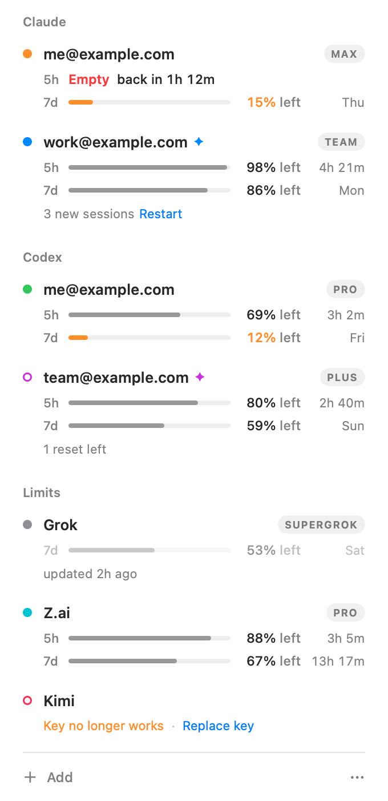
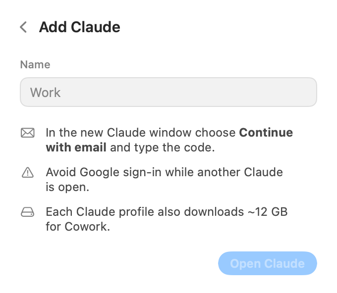
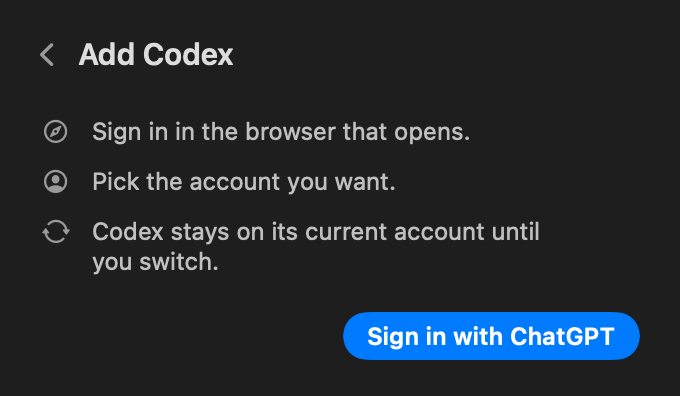

# OpenAccs

[](https://github.com/mikwiseman/openaccs/releases/latest)
[](#requirements)
[](LICENSE)

OpenAccs is a free, open-source macOS menu bar app and command-line tool that switches between several Claude and Codex (ChatGPT) accounts, shares one Claude Code history across your Claude accounts, and shows how much is left of the usage limits of Claude, Claude Code, Codex, Grok, Kimi Code and the Z.ai GLM Coding Plan.

Each Claude account runs as its own Claude desktop profile. Every profile uses the same `~/.claude` folder, so your Claude Code settings, skills and sessions are the same on every account. You switch Codex accounts from the same panel, and the switch covers the ChatGPT app and the `codex` CLI together. OpenAccs never reads or copies your Claude login.

<p align="center">
  <picture>
    <source media="(prefers-color-scheme: dark)" srcset="docs/images/panel-dark.png">
    
  </picture>
</p>

<p align="center"><a href="https://github.com/mikwiseman/openaccs/releases/latest">Download the latest release</a> for macOS 26 or later on Apple silicon and Intel.</p>

## What OpenAccs does

### Use several Claude accounts in the Claude desktop app

The Claude desktop app shows one account at a time. OpenAccs gives each Claude account its own Claude profile, which is a separate Claude data folder with its own sign-in. When you click an account in the panel, OpenAccs opens Claude on that profile, or brings its window forward if it's already open. Several accounts can be open side by side, and you sign in to each profile once, inside Claude itself.

### Share Claude Code history between Claude accounts

Every profile that OpenAccs opens uses the same `~/.claude` folder. Claude Code keeps its settings, skills, `CLAUDE.md`, MCP servers, memory and session transcripts there, so all your Claude accounts work with one setup and one history.

The Code tab in the Claude app lists only the sessions of the account that is signed in. OpenAccs adds each session to the Code tab of your other profiles, so you can start a task on one account and continue it on another when the first account reaches its limit.

- A profile that is closed shows the new sessions the next time it opens.
- A profile that is open loads them after a restart. OpenAccs shows "3 new sessions" and a Restart link on that account.
- A session you delete in one account is not added back to the others.

### Switch Codex accounts in the ChatGPT app and the codex CLI

Codex lives in the ChatGPT desktop app. The app and every `codex` CLI read the same sign-in file, `~/.codex/auth.json`. OpenAccs keeps a copy of each Codex sign-in in the macOS Keychain and switches accounts by swapping that file.

A running Codex keeps its account in memory, so OpenAccs quits the ChatGPT app before the swap and opens it again afterwards. Then it checks that Codex came back on the account you chose. Your local Codex history stays in place, because Codex doesn't split it by account. Cloud tasks, connectors and chats belong to each account and change with it.

### See usage limits for Claude, Codex, Grok, Kimi and Z.ai

Each account row shows how much is left of each limit and when it resets. A full bar means the limit is untouched, and it empties as you use it. A bar turns orange when 20% or less is left. An empty limit shows "Empty" in red and when it comes back. A small star (✦) marks the account with the most left for each product, or, when all of them are empty, the one that comes back first. The menu bar icon has two rings for what's left of the 5-hour and weekly limits of the Claude account you used last.

| Provider | What OpenAccs shows | How you connect it |
| --- | --- | --- |
| Claude | What's left of the 5-hour and weekly limits. After you connect exact limits, it also shows reset times, your plan and extra usage spend. | Nothing to set up. OpenAccs reads the usage file (`plan-usage-history.json`) that the Claude app writes for each profile, with no sign-in. For reset times, [connect Claude Code once](#connect-exact-claude-limits). |
| Codex | What's left of the 5-hour and weekly limits with reset times, a monthly limit for credit-based workspaces, your credit balance and banked limit resets. | Your Codex sign-in. OpenAccs reads the same numbers the Codex app shows, from ChatGPT's usage endpoint. |
| Grok | What's left of the weekly limit, reset time and plan. | The Grok Bot app's local cache, with no sign-in and no network. Or the official Grok CLI for SuperGrok and Grok Build, which is experimental. |
| Kimi Code | What's left of the 5-hour, weekly and monthly limits with reset times, your plan and the extra usage wallet. | A Kimi Code API key. |
| Z.ai GLM Coding Plan | What's left of the 5-hour and weekly limits with reset times, and your plan. | A Z.ai API key, or a BigModel key in China. |

OpenAccs reads local files every minute and asks providers and CLIs every 5 to 15 minutes. To update now, choose Refresh in the More menu (the three dots).

## Privacy and safety

- **Claude.** OpenAccs never reads, stores or copies Claude credentials. To open an account, OpenAccs starts the Claude app with `--user-data-dir` set to that profile's folder, and you sign in inside Claude. It never opens Claude's `config.json`, where Claude keeps its encrypted login. For exact limits, OpenAccs runs Anthropic's own unmodified `claude` CLI, which signs in through Anthropic's browser page and keeps its own login. OpenAccs only reads the CLI's answer about usage.
- **Codex.** OpenAccs keeps each saved Codex sign-in in the macOS Keychain, never in a plain file. The active sign-in stays in `~/.codex/auth.json`, where Codex keeps it anyway. OpenAccs renews the tokens of saved accounts that aren't active through OpenAI's own sign-in server, and it leaves the active sign-in to Codex.
- **API keys.** OpenAccs keeps Kimi and Z.ai keys in the macOS Keychain. It checks each key with the provider before it saves it, so a mistyped key never becomes an account.
- **Network.** OpenAccs has no analytics, no telemetry and no update check. It talks only to `chatgpt.com` and `auth.openai.com` for Codex, `api.kimi.com` or `api.kimi.ai` for Kimi, and `api.z.ai` or `open.bigmodel.cn` for Z.ai. The Claude and Grok CLIs talk to their own servers themselves.
- **Command line.** The `openaccs` command talks to the app over a socket in `~/Library/Application Support/OpenAccs/`, which only your user account can open. Keys you add from the terminal are read from stdin and never written to logs.
- **Your files.** Every write is atomic, so a crash never leaves a half-written file. OpenAccs never edits a file that a running app is using. Before it replaces or removes anything, it copies the old version to `~/Library/Application Support/OpenAccs/Backups/`.
- **Sign-outs.** OpenAccs never signs out of anything. Removing an account removes it from OpenAccs only, and the Claude profile and its history stay on disk. Signing out of Codex would revoke that sign-in everywhere, so OpenAccs never does it.

OpenAccs keeps its own data in `~/Library/Application Support/OpenAccs/`. The file `accounts.json` holds account names and colors and no secrets.

## Install

### Requirements

- macOS 26 (Tahoe) or later, on Apple silicon or Intel.
- The Claude desktop app in `/Applications`, for Claude accounts.
- The ChatGPT desktop app with Codex in `/Applications`, for Codex accounts.
- Claude Code, if you want exact Claude limits. OpenAccs uses `~/.local/bin/claude`, or the copy of Claude Code that the Claude app downloads.
- The Grok Bot app or the Grok CLI, if you want Grok limits.

### Download

1. Download `OpenAccs-<version>.zip` from [GitHub Releases](https://github.com/mikwiseman/openaccs/releases/latest).
2. Unzip it and move `OpenAccs.app` to your Applications folder.
3. Open OpenAccs. Its icon appears in the menu bar, and it has no Dock icon.

The app is signed with a Developer ID and notarized by Apple. On first launch, OpenAccs adds the Claude profile, the Codex sign-in and the Grok Bot account that it finds on your Mac. To start OpenAccs when you log in, turn on Launch at Login in the More menu.

### Build from source

You need Xcode 26 or later and [XcodeGen](https://github.com/yonaskolb/XcodeGen).

```sh
brew install xcodegen
git clone https://github.com/mikwiseman/openaccs.git
cd openaccs
xcodegen generate
open OpenAccs.xcodeproj
```

You can also build from the command line.

```sh
xcodebuild -project OpenAccs.xcodeproj -scheme OpenAccs -configuration Release build
```

Local builds are signed to run on your own Mac. To run the tests of one package target, pass its name (`OpenAccsCore`, `ClaudeKit`, `CodexKit` or `LimitsKit`) to the test script.

```sh
scripts/test-kit.sh ClaudeKit
```

To check the panel without clicking, render it to a PNG. The `--demo` flag uses sample accounts, and `--dark` uses dark mode.

```sh
/path/to/OpenAccs.app/Contents/MacOS/OpenAccs --snapshot panel.png --demo --dark
```

For maintainers, `scripts/release.sh` builds the app, signs it with a Developer ID, notarizes and staples it, and writes `build/OpenAccs-<version>.zip`. It needs a Developer ID Application certificate (set `TEAM_ID` to your team) and an App Store Connect API key in `~/.appstoreconnect/config.json`. Set `NOTARIZE=0` to skip notarization.

| Folder | What it holds |
| --- | --- |
| `OpenAccs/` | The menu bar app, its SwiftUI panel and the app model. |
| `Packages/OpenAccsKit/` | `OpenAccsCore` (accounts, Keychain, atomic files, processes), `ClaudeKit` (profiles, session sharing, Claude limits), `CodexKit` (Codex switching and limits) and `LimitsKit` (Grok, Kimi and Z.ai). |
| `scripts/` | The test, release and icon scripts. |
| [`DESIGN.md`](DESIGN.md) | The principles, the architecture and the facts about each app that the design rests on. |

## How to use it

### Add a Claude account

1. Click Add at the bottom of the panel and choose Claude.
2. Type a name, e.g. "Work", and click Open Claude. OpenAccs creates a new profile and opens a new Claude window for it.
3. In that window, choose Continue with email and type the code that Anthropic sends you.

Avoid Google sign-in while another Claude window is open, because the sign-in link goes to the Claude window that opened first. Each new profile also downloads about 12 GB for Cowork.

<p align="center"></p>

### Switch Codex accounts

1. Click Add and choose Codex, then click Sign in with ChatGPT.
2. Sign in in the browser that opens and pick the account you want. OpenAccs runs `codex login` in a private folder, so your current Codex sign-in doesn't change.
3. To switch, click a Codex account in the panel and confirm Restart Codex.

Close any `codex` sessions in Terminal before you switch, because they keep the old account in memory. If you sign in to another account inside Codex itself, OpenAccs notices it and adds it to the panel.

<p align="center"></p>

### Connect exact Claude limits

1. Right-click (or Control-click) a Claude account and choose Connect Exact Limits.
2. Your browser opens Anthropic's sign-in page for Claude Code. Sign in with the same account as that profile.

OpenAccs checks that Claude Code signed in to the same account as the profile, and it refuses to show another account's limits under it. From then on, the row shows reset times and your plan.

### Add a Kimi Code or Z.ai key

1. Click Add and choose Kimi or Z.ai.
2. Paste the API key and choose Global or China.
3. Click Add. OpenAccs checks the key with the provider before it saves it.

You can create a Kimi Code key in the [Kimi Code console](https://www.kimi.ai/code/console) and a Z.ai key on the [Z.ai API keys page](https://z.ai/manage-apikey/apikey-list). In China, use [kimi.com/code/console](https://www.kimi.com/code/console) for Kimi and [open.bigmodel.cn](https://open.bigmodel.cn) for Z.ai.

### Add Grok

Click Add and choose Grok. If the Grok Bot app is signed in on your Mac, its accounts appear in the list, and you click Add next to one. To use the Grok CLI instead, click Sign in under Grok CLI, and OpenAccs runs `grok login` in a private folder.

### Use OpenAccs from the terminal

OpenAccs installs the `openaccs` command in `~/.local/bin` when that folder exists. The command does everything the panel does, through the running app, so it follows the same rules and needs no extra permissions.

```sh
openaccs                    # what's left on every account, and when it comes back
openaccs best claude        # the Claude account with the most left
openaccs use work           # open the "work" Claude profile, or switch Codex to it
openaccs use --best codex   # switch Codex to the account with the most left
openaccs status --json      # the same data for scripts
```

| Command | What it does |
| --- | --- |
| `openaccs [status] [provider] [--json]` | What's left on every account, and when it comes back. `limits` works too. |
| `openaccs best <provider> [--json]` | The account with the most left. |
| `openaccs use <account> [--yes]` | Claude: open that profile. Codex: switch to it (asks first unless you pass `--yes`). Others: open the usage page. `switch` and `open` work too. |
| `openaccs use --best <provider> [--yes]` | The same, for the account with the most left. |
| `openaccs restart <account>` | Restart a Claude profile so it loads new sessions. |
| `openaccs refresh [--json]` | Ask every provider now, then show the status. |
| `openaccs connect <account>` | Connect exact Claude limits (Claude Code sign-in in the browser). |
| `openaccs add claude <name>` | Add a Claude profile. Also `add codex`, `add grok`, `add grok-bot`, and `add kimi` or `add zai` with a key (`-` or no key reads it from stdin, out of your shell history; `--china` for China accounts). |
| `openaccs rename <account> <new name>` and `openaccs remove <account> [--yes]` | Rename or remove an account. |

An `<account>` is a name or a unique part of it, `provider:name`, or the number that `status` shows. If OpenAccs isn't running, the command starts it in the background. The exit code is 0 on success, 1 on an error, 2 on a usage mistake and 3 when OpenAccs can't be reached. You can also run the command as `/Applications/OpenAccs.app/Contents/MacOS/OpenAccs cli <command>`.

### Manage accounts

Right-click any account to rename it, change its color or remove it. For a Claude account, you can also show its data folder. Removing an account never signs it out.

## FAQ

### How do I use two Claude accounts on one Mac at the same time?

Add each account in OpenAccs. Each account gets its own Claude profile, so both can be open at once in separate Claude windows. Click an account in the menu bar panel to bring its window forward.

### How do I switch Claude accounts without logging out?

Click the other account in OpenAccs. Each account stays signed in to its own profile, so you never sign out to switch.

### Can I continue a Claude Code session on another Claude account?

Yes. Every profile shares `~/.claude`, and OpenAccs adds your sessions to the Code tab of every account. When one account reaches its 5-hour or weekly limit, open the same session in another account and continue there. Close the session in the first window before you continue, because two windows writing to one session split the conversation.

### Does OpenAccs change the account of `claude` in my terminal?

No. OpenAccs switches the Claude desktop app only, and the `claude` command keeps its own sign-in. Both use `~/.claude`, so your settings, skills, `CLAUDE.md` and MCP servers are the same everywhere.

### How do I switch accounts in Codex or the ChatGPT app?

Add each ChatGPT account under Codex, then click the one you want and confirm Restart Codex. OpenAccs quits the ChatGPT app, swaps `~/.codex/auth.json` and opens the app again. The `codex` CLI reads the same file, so it switches too.

### Will switching Codex accounts lose my history?

No. Codex keeps local history in `~/.codex` for all accounts, and OpenAccs only replaces `auth.json`. Cloud tasks, connectors and chats belong to each account.

### How do I see when my Claude 5-hour limit resets?

Right-click the Claude account and choose Connect Exact Limits. After you sign in to Claude Code once, OpenAccs shows when the 5-hour and weekly limits reset. Without that step, it shows the percentages from the Claude app without reset times.

### How do I check my Claude and Codex limits from the terminal?

Run `openaccs`. It prints what's left on every account and when each limit comes back, and `openaccs status --json` gives the same data to scripts.

### How do I check my Codex usage limits?

Add your Codex account. OpenAccs shows what's left of the 5-hour and weekly limits with reset times, your credit balance and your banked resets, which are the same numbers the Codex app shows.

### How do I check my Z.ai GLM Coding Plan usage?

Add your Z.ai API key, or your BigModel key in China. OpenAccs shows what's left of the 5-hour and weekly quota with reset times.

### How do I check my Kimi Code usage?

Add your Kimi Code API key. OpenAccs shows what's left of the 5-hour, weekly and monthly quota with reset times.

### Can I see my Grok usage?

Yes. If the Grok Bot app is signed in on your Mac, OpenAccs reads its weekly usage with no sign-in. The Grok CLI option for SuperGrok and Grok Build is experimental.

### Does OpenAccs see my passwords or tokens?

OpenAccs never sees Claude passwords or tokens. It keeps Codex sign-ins and Kimi and Z.ai keys in the macOS Keychain on your Mac, and it sends each one only to its own provider.

### Does OpenAccs send my data anywhere?

No. OpenAccs has no analytics or telemetry, and it talks only to the providers' own usage and sign-in servers.

### Why does each Claude profile take 12 GB?

Each Claude profile downloads its own copy of the virtual machine that Cowork runs in, which is about 12 GB. OpenAccs shows that cost before you add a profile.

### Does OpenAccs work on Intel Macs or older versions of macOS?

It works on Intel and Apple silicon Macs that run macOS 26 or later. It doesn't run on older versions of macOS.

### How is OpenAccs different from CodexBar?

[CodexBar](https://github.com/steipete/CodexBar) shows usage limits for many AI providers. OpenAccs focuses on switching between several Claude and Codex accounts and on sharing one Claude Code history across them, and it shows limits for five providers.

### Is OpenAccs free?

Yes. OpenAccs is free and open source under the MIT license.

## Limitations

- A Claude window that is already open shows sessions from your other accounts only after it restarts. OpenAccs shows how many sessions are waiting, with a Restart link.
- Don't continue the same session in two Claude windows at once. Both windows write to the same transcript, and the conversation splits into two.
- Claude sign-in links (Google, SSO and the email link) and notification clicks go to the Claude window that opened first. Use Continue with email and the code when another Claude window is open.
- Every Claude window has the same icon in the Dock and in the app switcher. Use OpenAccs to pick the right one.
- Each Claude profile downloads its own Cowork virtual machine of about 12 GB.
- Without exact limits, Claude numbers update only while that profile is open, and they have no reset times. A row shows "as of 2h ago" when its numbers are old.
- A Codex switch quits and reopens the ChatGPT app. OpenAccs won't switch while a `codex` session runs in Terminal, because that session would keep the old account.
- OpenAccs switches only Codex sign-ins stored in `~/.codex/auth.json`. It won't switch when Codex keeps its sign-in in the keychain (`cli_auth_credentials_store` in `~/.codex/config.toml`) or in `~/.codex/secrets`.
- The Grok CLI option relies on an undocumented billing call, so it is experimental.
- Kimi Code and Z.ai support has been checked against their documented API responses only.
- OpenAccs expects `Claude.app` and `ChatGPT.app` in `/Applications`.

## Not affiliated

OpenAccs is an independent project. It is not affiliated with, endorsed by or sponsored by Anthropic, OpenAI, xAI, Moonshot AI or Zhipu AI (Z.ai). Claude, Claude Code, Codex, ChatGPT, Grok, Kimi, GLM and Z.ai are trademarks of their owners.

## Credits

OpenAccs used [CodexBar](https://github.com/steipete/CodexBar) by Peter Steinberger (MIT license) as a reference for the provider usage endpoints.

## License

OpenAccs is released under the [MIT license](LICENSE). Copyright 2026 Mik Wiseman.
