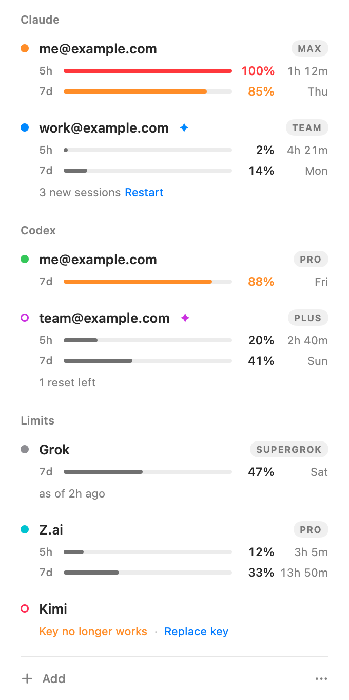
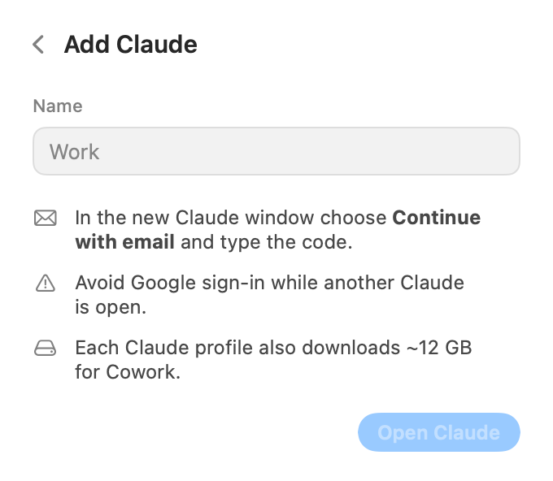
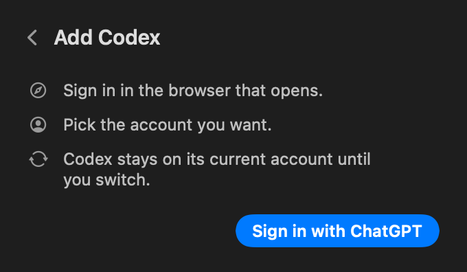

# OpenAccs

[](https://github.com/mikwiseman/openaccs/releases/latest)
[](#requirements)
[](LICENSE)

OpenAccs is a free, open-source macOS menu bar app and command-line tool that switches between several Claude and Codex (ChatGPT) accounts, shares one Claude Code history across your Claude accounts, and shows how much is left of the usage limits of Claude, Claude Code, Codex, Grok, Kimi Code and the Z.ai GLM Coding Plan.

Each Claude account runs as its own Claude desktop profile. Every profile uses the same `~/.claude` folder, so your Claude Code settings, skills and sessions are the same on every account. Codex accounts also open in independent desktop profiles. Clicking an open account brings its existing window forward.

<p align="center">
  <picture>
    <source media="(prefers-color-scheme: dark)" srcset="docs/images/panel-dark.png">
    
  </picture>
</p>

<p align="center"><a href="https://github.com/mikwiseman/openaccs/releases/latest">Download the latest release</a> for macOS 26 or later on Apple silicon and Intel.</p>

## What OpenAccs does

### Use several Claude accounts in the Claude desktop app

The Claude desktop app shows one account at a time. OpenAccs gives each Claude account its own Claude profile, which is a separate Claude data folder with its own sign-in. When you click an account in the panel, OpenAccs opens Claude on that profile, or brings its window forward if it's already open. Several accounts can be open side by side, and you sign in to each profile once, inside Claude itself.

### Share Claude Code history between Claude accounts

Every profile that OpenAccs opens uses the same `~/.claude` folder. Claude Code keeps its settings, skills, `CLAUDE.md`, MCP servers, memory and session transcripts there, so all your Claude accounts work with one setup and one history.

The Code tab in the Claude app lists only the sessions of the account that is signed in. OpenAccs adds each session to the Code tab of your other profiles, so you can start a task on one account and continue it on another when the first account reaches its limit.

- Archived sessions, the permission mode, the effort, Ultracode and the model of each session are the same everywhere. The last change wins, in whichever window you make it.
- Each window keeps its own pinned chats. To pin the same chats everywhere, turn on Settings → General → Sync pinned chats. Turning it on keeps every pin from every window.
- The Claude app's own settings are the same in every window too: its preferences, the permission mode of each folder, how new sessions start (model, effort and fast mode) and the chat MCP servers. Change one in any window and the others take it. The first time, every window takes the default window's settings and keeps the folder modes of all of them. A new window starts with them.
- Sessions use Date grouping and Last updated, descending. OpenAccs updates Claude's account-owned preference after sign-in, preserving pins and custom sections. An open window may need a reload to display a changed preference; OpenAccs never forces one.
- A native `permissions.defaultMode` of `bypassPermissions` also enables the desktop's bypass toggle for each authorized account. New profiles receive the global toggle before launch; account-specific changes wait until the profile is closed. Model, effort and speed are unchanged by these defaults.
- Every account you have signed in to in a window gets the same list, so signing in to another account inside one window shows the same sessions too.
- A profile that is closed shows everything the next time it opens.
- Clicking a running profile only shows its window. Shared session changes load at its next restart; **… → Restart Claude…** is always explicit.
- If a window is now signed in to another account than the one you added it with, the row says so, for example "Signed in as ai42@waiwai.is".
- A session you delete in one account is not added back to the others.

### Open several Codex accounts

Each account opens its own Codex process. Clicking it again shows the existing window. The original `~/.codex` account and terminal sessions stay untouched.

Additional profiles live under `~/.openaccs/codex/`, with separate sign-ins and browser data. Instructions, skills and configuration link to the shared setup. Local chats use Codex’s shared database directory and shared transcript folders, with native writer locks. New profiles import the existing project sidebar. Codex currently keeps later sidebar changes in each desktop process; OpenAccs does not overwrite a running window’s preferences.

### One setup for Claude and Codex

Settings → Setup shows instructions, skills and tools, with one **Review setup…** action. **Details…** holds conflicts, permissions, import and history:

- **Instructions.** One file, `~/.claude/CLAUDE.md`. Codex reads it through a link at `~/.codex/AGENTS.md`, so there is nothing to keep in sync.
- **Skills.** Stored once in `~/.agents/skills`, which Codex reads; Claude gets a link per skill in `~/.claude/skills`.
- **MCP servers.** The same servers in Claude Code and Codex, translated between their formats field by field. Keys stay as `${VAR}` references; a key written into a file is never copied.
- **Defaults.** Recommended settings for both: autonomy, keeping chats, hiding `.env` and logins from agents.

Nothing changes until you review the plan and apply it. Each change goes to History with Undo, and old files go to Backups first. Logins, connectors and account skills are never copied. If ChatGPT's own Import copies Claude into Codex, the Setup tab offers to turn it off and to remove what it copied. That includes the Codex chats it makes from Claude Code sessions: they move to Archived chats in Codex, so Claude sessions stay in Claude and Codex chats in Codex. A chat you continued in Codex, or brought back after OpenAccs archived it, stays.

The Instructions window edits your file, shows instruction files that people publish (with their licenses), adopts the rules you pick into your file through your own Claude Code, and has a six-question wizard for a short file of your own.

From the terminal: `openaccs setup`, `openaccs setup apply [--dry-run]`, `openaccs setup history` and `openaccs setup undo <n>`.

For a Linux server, preview with `openaccs vps user@host --dry-run`, then run `openaccs vps user@host` to install the tools and copy the portable setup. Use a non-root SSH user. Each tool signs in on the server itself; Mac logins and literal keys stay on the Mac. Codex device-code login must be enabled for that account.

### See usage limits for Claude, Codex, Grok, Kimi and Z.ai

Each account row shows how much is left of each limit and when it resets. A full bar means the limit is untouched, and it empties as you use it. A bar turns orange when 20% or less is left. An empty limit shows "Empty" in red and when it comes back. A small star (✦) marks the account with the most left for each product, or, when all of them are empty, the one that comes back first. The menu bar icon has two rings for what's left of the 5-hour and weekly limits of the Claude account you used last.

| Provider | What OpenAccs shows | How you connect it |
| --- | --- | --- |
| Claude | Fresh 5-hour and weekly limits, with reset times. | Uses the existing sign-in of that exact Claude desktop profile. Refresh may ask macOS for access to **Claude Safe Storage** once. No separate Claude Code login. |
| Codex | What's left of the 5-hour and weekly limits with reset times, a monthly limit for credit-based workspaces, your credit balance and banked limit resets. | Your Codex sign-in. OpenAccs reads the same numbers the Codex app shows, from ChatGPT's usage endpoint. |
| Grok | What's left of the weekly limit, reset time and plan. | The Grok Bot app's local cache, with no sign-in and no network. Or the official Grok CLI for SuperGrok and Grok Build, which is experimental. |
| Kimi Code | What's left of the 5-hour, weekly and monthly limits with reset times, your plan and the extra usage wallet. | A Kimi Code API key. |
| Z.ai GLM Coding Plan | What's left of the 5-hour and weekly limits with reset times, and your plan. | A Z.ai API key, or a BigModel key in China. |

OpenAccs reads local files every minute and asks providers and CLIs every 5 to 15 minutes. To update now, click the refresh button or press ⌘R.

## Privacy and safety

- **Claude.** OpenAccs reads the selected desktop profile's session cookie and decrypts it using **Claude Safe Storage** in the macOS Keychain. It uses that cookie only in memory, only for requests to `claude.ai`, and verifies the account before requesting its organization's limits. No browser profiles are searched, no cookies are copied or stored, and background refresh never opens a Keychain prompt. Cached percentages remain dated when refresh fails.
- **Codex.** Saved sign-ins live in the macOS Keychain. A running profile owns its private `auth.json` with owner-only permissions, as Codex normally does. OpenAccs never rotates a profile's refresh token behind its back. Removing a row preserves its profile and history.
- **API keys.** Kimi and Z.ai keys stay in the macOS Keychain and go only to their provider.
- **Network.** OpenAccs has no analytics and no telemetry. Once a day it checks for updates at `mikwiseman.github.io` (a feed signed with the OpenAccs key; turn this off in Settings), and every update asks before it installs. While the Instructions window is open, it loads the gallery from `mikwiseman.github.io` and the files in it from `raw.githubusercontent.com`. Otherwise it talks only to `claude.ai` for Claude, `chatgpt.com` and `auth.openai.com` for Codex, `api.kimi.com` or `api.kimi.ai` for Kimi, and `api.z.ai` or `open.bigmodel.cn` for Z.ai. The Claude and Grok CLIs talk to their own servers themselves.
- **Command line.** The `openaccs` command talks to the app over a socket in `~/Library/Application Support/OpenAccs/`, which only your user account can open. Keys you add from the terminal are read from stdin and never written to logs.
- **Your files.** Every write is atomic, so a crash never leaves a half-written file. OpenAccs never edits a file that a running app is using. Before it replaces or removes anything, it copies the old version to `~/Library/Application Support/OpenAccs/Backups/`.
- **Sign-outs.** OpenAccs never signs out of anything. Removing an account removes it from OpenAccs only, and the Claude profile and its history stay on disk. Signing out of Codex would revoke that sign-in everywhere, so OpenAccs never does it.

OpenAccs keeps its own data in `~/Library/Application Support/OpenAccs/`. The file `accounts.json` holds account names and colors and no secrets.

## Install

### Requirements

- macOS 26 (Tahoe) or later, on Apple silicon or Intel.
- The Claude desktop app in `/Applications`, for Claude accounts.
- The ChatGPT desktop app with Codex in `/Applications`, for Codex accounts.
- Claude desktop signed in, for Claude limits. macOS may ask for access to Claude Safe Storage when you first refresh.
- The Grok Bot app or the Grok CLI, if you want Grok limits.

### Download

In Terminal, one command:

```sh
curl -fsSL https://mikwiseman.github.io/openaccs/install.sh | sh
```

It takes the newest release, checks that Apple notarized it and that it is signed by OpenAccs's developer, moves it to Applications and opens it. Or by hand:

1. Download `OpenAccs-<version>.zip` from [GitHub Releases](https://github.com/mikwiseman/openaccs/releases/latest).
2. Unzip it and move `OpenAccs.app` to your Applications folder.
3. Open OpenAccs. Its icon appears in the menu bar, and it has no Dock icon.

The app is signed with a Developer ID and notarized by Apple. On first launch, OpenAccs adds the Claude profile, the Codex sign-in and the Grok Bot account that it finds on your Mac. To start OpenAccs when you log in, turn on Launch at login in Settings (More menu → Settings…). OpenAccs updates itself from then on.

### Build from source

You need Xcode 26 or later and [XcodeGen](https://github.com/yonaskolb/XcodeGen).

```sh
brew install xcodegen
git clone https://github.com/mikwiseman/openaccs.git
cd openaccs
xcodegen generate
open OpenAccs.xcodeproj
```

You can also build from the command line.

```sh
xcodebuild -project OpenAccs.xcodeproj -scheme OpenAccs -configuration Release build
```

Local builds are signed to run on your own Mac. To run the tests of one package target, pass its name (`OpenAccsCore`, `ClaudeKit`, `CodexKit` or `LimitsKit`) to the test script.

```sh
scripts/test-kit.sh ClaudeKit
```

To check the panel without clicking, render it to a PNG. The `--demo` flag uses sample accounts, and `--dark` uses dark mode.

```sh
/path/to/OpenAccs.app/Contents/MacOS/OpenAccs --snapshot panel.png --demo --dark
```

For maintainers, `scripts/release.sh` builds the app, signs it with a Developer ID, notarizes and staples it, and writes `build/OpenAccs-<version>.zip`. It needs a Developer ID Application certificate (set `TEAM_ID` to your team) and an App Store Connect API key in `~/.appstoreconnect/config.json`. Set `NOTARIZE=0` to skip notarization.

| Folder | What it holds |
| --- | --- |
| `OpenAccs/` | The menu bar app, its SwiftUI panel and the app model. |
| `Packages/OpenAccsKit/` | `OpenAccsCore` (accounts, Keychain, atomic files, processes), `ClaudeKit` (profiles, session sharing, Claude limits), `CodexKit` (Codex switching and limits) and `LimitsKit` (Grok, Kimi and Z.ai). |
| `scripts/` | The test, release and icon scripts. |
| [`DESIGN.md`](DESIGN.md) | The principles, the architecture and the facts about each app that the design rests on. |

## How to use it

### Add a Claude account

For Personal and Team memberships of the same login, choose **Discover memberships** in the account’s menu or Add Claude. OpenAccs reads the existing desktop session and adds each membership once, with its own saved account + organization identity and limits. If the profile’s selected membership is unknown, select it in Claude first. No additional sign-in or desktop profile is created.

Both rows share a window. **Other membership** means that window currently uses another membership: choose the requested membership in Claude’s account menu. Quotas stay attached to their own membership. `openaccs memberships <account> --json` performs the same discovery from a saved profile; omit the account to use the main Claude profile.

**Connect CLI…** prepares a native sign-in command for that membership’s separate CLI folder. Run it yourself, then verify the native account and organization. Desktop sign-in does not authorize the CLI or a remote host.

1. Click Add at the bottom of the panel and choose Claude.
2. Type a name, e.g. "Work", and click Open Claude. OpenAccs creates a new profile and opens a new Claude window for it.
3. In that window, choose Continue with email and type the code that Anthropic sends you.

Avoid Google sign-in while another Claude window is open, because the sign-in link goes to the Claude window that opened first. Each new profile also downloads about 12 GB for Cowork.

<p align="center"></p>

### Open a Codex account

1. Choose **Add account → Codex** and sign in with ChatGPT.
2. Click the saved account to open its window. Other accounts keep running.
3. Click it again to bring that same window forward.

<p align="center"></p>

### Refresh Claude limits

Use the refresh button. OpenAccs uses the sign-in already in Claude; macOS may ask you to allow **Claude Safe Storage** access. Limits refresh every five minutes. If the request fails, the previous measurement keeps its original timestamp and the row explains the failure.


### Add a Kimi Code or Z.ai key

1. Click Add and choose Kimi or Z.ai.
2. Paste the API key and choose Global or China.
3. Click Add. OpenAccs checks the key with the provider before it saves it.

You can create a Kimi Code key in the [Kimi Code console](https://www.kimi.ai/code/console) and a Z.ai key on the [Z.ai API keys page](https://z.ai/manage-apikey/apikey-list). In China, use [kimi.com/code/console](https://www.kimi.com/code/console) for Kimi and [open.bigmodel.cn](https://open.bigmodel.cn) for Z.ai.

### Add Grok

Click Add and choose Grok. If the Grok Bot app is signed in on your Mac, its accounts appear in the list, and you click Add next to one. To use the Grok CLI instead, click Sign in under Grok CLI, and OpenAccs runs `grok login` in a private folder.

### Use OpenAccs from the terminal

OpenAccs installs the `openaccs` command in `~/.local/bin` when that folder exists. The command does everything the panel does, through the running app, so it follows the same rules and needs no extra permissions.

```sh
openaccs                    # what's left on every account, and when it comes back
openaccs best claude        # the Claude account with the most left
openaccs use work           # show or open the account’s window
openaccs launch --all --json # open saved Claude and Codex profiles; leave running ones untouched
openaccs use --best codex   # show the Codex account with the most left
openaccs status --json      # the same data for scripts
```

| Command | What it does |
| --- | --- |
| `openaccs [status] [provider] [--json]` | What's left on every account, and when it comes back. `limits` works too. |
| `openaccs best <provider> [--json]` | The account with the most left. |
| `openaccs use <account> [--json]` | Claude and Codex: show or open that profile. Others: open the usage page. JSON returns the selected account with its current PID and window IDs. `switch` and `open` work too. |
| `openaccs use --best <provider> [--json]` | The same, for the account with the most left. |
| `openaccs launch <account>… [--json]` or `openaccs launch --all [--json]` | Open selected or all saved Claude and Codex profiles. Running profiles are skipped, even with pending changes. Quote names containing spaces. |
| `openaccs restart <account>` | Restart a Claude profile so it loads new sessions. |
| `openaccs refresh [--json]` | Ask every provider now, then show the status. |
| `openaccs connect <account>` | Legacy alias for refreshing Claude limits. |
| `openaccs add claude <name>` | Add a Claude profile. Also `add codex`, `add grok`, `add grok-bot`, and `add kimi` or `add zai` with a key (`-` or no key reads it from stdin, out of your shell history; `--china` for China accounts). |
| `openaccs rename <account> <new name>` and `openaccs remove <account> [--yes]` | Rename or remove an account. |

An `<account>` is a name or a unique part of it, `provider:name`, or the number that `status` shows. If OpenAccs isn't running, the command starts it in the background. The exit code is 0 on success, 1 on an error, 2 on a usage mistake and 3 when OpenAccs can't be reached. You can also run the command as `/Applications/OpenAccs.app/Contents/MacOS/OpenAccs cli <command>`.

`launch --json` returns a `results` array with each profile's `id`, `label`, `status` (`opened`, `already_open` or `failed`), and `pid` or `error`. Repeated or concurrent commands keep one process per profile. The whole selection is checked before launch; one launch failure doesn't stop the remaining profiles.

### Manage accounts

Click **Arrange** in the panel to drag whole sections or move accounts within a section. You can also select a row and press **⌥↑** or **⌥↓**. OpenAccs remembers the order, and the CLI uses the same row numbers.

Open an account's **…** menu to rename it, change its color or remove it. Removal asks you to confirm the named account. Removing Claude leaves its profile and shared history on disk. Its menu also offers Show Data Folder and Restart Claude.

New Claude profiles hide Claude's menu-bar icon by default; OpenAccs remains in the menu bar. An explicit shared preference is preserved. To change an existing window without restarting, use Claude → Settings → System → Menu bar.

## FAQ

### How do I use two Claude accounts on one Mac at the same time?

Add each account in OpenAccs. Each account gets its own Claude profile, so both can be open at once in separate Claude windows. Click an account in the menu bar panel to bring its window forward.

### How do I switch Claude accounts without logging out?

Click the other account in OpenAccs. Each account stays signed in to its own profile, so you never sign out to switch.

### Can I continue a Claude Code session on another Claude account?

Yes. Every profile shares `~/.claude`, and OpenAccs adds your sessions to the Code tab of every account. When one account reaches its 5-hour or weekly limit, open the same session in another account and continue there. Close the session in the first window before you continue, because two windows writing to one session split the conversation.

### Does OpenAccs change the account of `claude` in my terminal?

No. OpenAccs switches the Claude desktop app only, and the `claude` command keeps its own sign-in. Both use `~/.claude`, so your settings, skills, `CLAUDE.md` and MCP servers are the same everywhere.

### How do I switch accounts in Codex or the ChatGPT app?

Add each account under Codex, then click the one you want. It opens its own profile. Existing windows and the terminal login keep their accounts.

### Will switching Codex accounts lose my history?

Local chat history stays in `~/.codex` and is shared by the account windows. Existing project folders are imported when a profile first opens. Cloud tasks, connectors, browser sessions and Work preferences belong to each account.

### How do I see when my Claude 5-hour limit resets?

Refresh reads current limits using that Claude window's existing sign-in. A failed refresh keeps the previous reading and its age.

### How do I check my Claude and Codex limits from the terminal?

Run `openaccs`. It prints what's left on every account and when each limit comes back, and `openaccs status --json` gives the same data to scripts.

### How do I check my Codex usage limits?

Add your Codex account. OpenAccs shows what's left of the 5-hour and weekly limits with reset times, your credit balance and your banked resets, which are the same numbers the Codex app shows.

### How do I check my Z.ai GLM Coding Plan usage?

Add your Z.ai API key, or your BigModel key in China. OpenAccs shows what's left of the 5-hour and weekly quota with reset times.

### How do I check my Kimi Code usage?

Add your Kimi Code API key. OpenAccs shows what's left of the 5-hour, weekly and monthly quota with reset times.

### Can I see my Grok usage?

Yes. If the Grok Bot app is signed in on your Mac, OpenAccs reads its weekly usage with no sign-in. The Grok CLI option for SuperGrok and Grok Build is experimental.

### Does OpenAccs see my passwords or tokens?

OpenAccs uses the Claude desktop session in memory and keeps saved Codex sign-ins and API keys in the macOS Keychain. Each credential goes only to its own provider; each Codex profile owns its private native auth file.

### Does OpenAccs send my data anywhere?

No. OpenAccs has no analytics or telemetry, and it talks only to the providers' own usage and sign-in servers.

### Why does each Claude profile take 12 GB?

Each Claude profile downloads its own copy of the virtual machine that Cowork runs in, which is about 12 GB. OpenAccs shows that cost before you add a profile.

### Does OpenAccs work on Intel Macs or older versions of macOS?

It works on Intel and Apple silicon Macs that run macOS 26 or later. It doesn't run on older versions of macOS.

### How is OpenAccs different from CodexBar?

[CodexBar](https://github.com/steipete/CodexBar) shows usage limits for many AI providers. OpenAccs focuses on switching between several Claude and Codex accounts and on sharing one Claude Code history across them, and it shows limits for five providers.

### Is OpenAccs free?

Yes. OpenAccs is free and open source under the MIT license.

## Limitations

- A Claude window loads shared changes after an explicit restart. Clicking or `launch` never restarts a running profile.
- Don't continue the same session in two Claude windows at once. Both windows write to the same transcript, and the conversation splits into two.
- Claude sign-in links (Google, SSO and the email link) and notification clicks go to the Claude window that opened first. Use Continue with email and the code when another Claude window is open.
- Every Claude window has the same icon in the Dock and in the app switcher. Use OpenAccs to pick the right one.
- Each Claude profile downloads its own Cowork virtual machine of about 12 GB.
- Claude's saved measurements can be hours old and contain no reset times. OpenAccs labels their age, fades old readings and drops a window after its duration passes. Live polling needs a matching Claude Code sign-in; it never copies desktop credentials.
- Codex account windows share local chat history. Finish or close an active chat before continuing it under another account; native writer locks prevent two processes from writing it at once. The terminal keeps using its existing `~/.codex` account. Project sidebar changes and account-level Work preferences are not continuously synchronized between separate desktop processes.
- New Codex profiles use the native file credential store and keep separate auth files. SQLite state uses Codex’s `CODEX_SQLITE_HOME` setting; individual SQLite files and WAL sidecars are never copied or linked separately.
- The Grok CLI option relies on an undocumented billing call, so it is experimental.
- Kimi Code and Z.ai support has been checked against their documented API responses only.
- OpenAccs expects `Claude.app` and `ChatGPT.app` in `/Applications`.

## Not affiliated

OpenAccs is an independent project. It is not affiliated with, endorsed by or sponsored by Anthropic, OpenAI, xAI, Moonshot AI or Zhipu AI (Z.ai). Claude, Claude Code, Codex, ChatGPT, Grok, Kimi, GLM and Z.ai are trademarks of their owners.

## Credits

OpenAccs used [CodexBar](https://github.com/steipete/CodexBar) by Peter Steinberger (MIT license) as a reference for the provider usage endpoints.

## License

OpenAccs is released under the [MIT license](LICENSE). Copyright 2026 Mik Wiseman.

### Choosing windows from an agent

`openaccs use <account> --json` selects the account and returns that account alone, including its current `pid` and `windowIDs`. It reads these after opening the profile and fails if the account disappeared or its app has no live process. `openaccs status --json` lists these targets for every saved account. `openaccs launch <account> --json` opens a missing profile in the background and returns the existing PID when it is already open.

Target the returned PID or window ID in the computer-use tool. Claude profiles share one application name and bundle ID, so a tool that selects only `Claude` or `com.anthropic.claudefordesktop` can attach to a different account even after `use` succeeds. Use a controller that accepts an exact process or window. Re-read status after an app update or restart because native identifiers change. This selects the desktop profile, not the standalone Claude CLI sign-in.

To regression-test selection without opening real profiles, run `python3 scripts/test-cli-selection.py /path/to/Debug/OpenAccs.app/Contents/MacOS/OpenAccs`. It uses an isolated control socket and rejects Release builds before issuing an open request.
